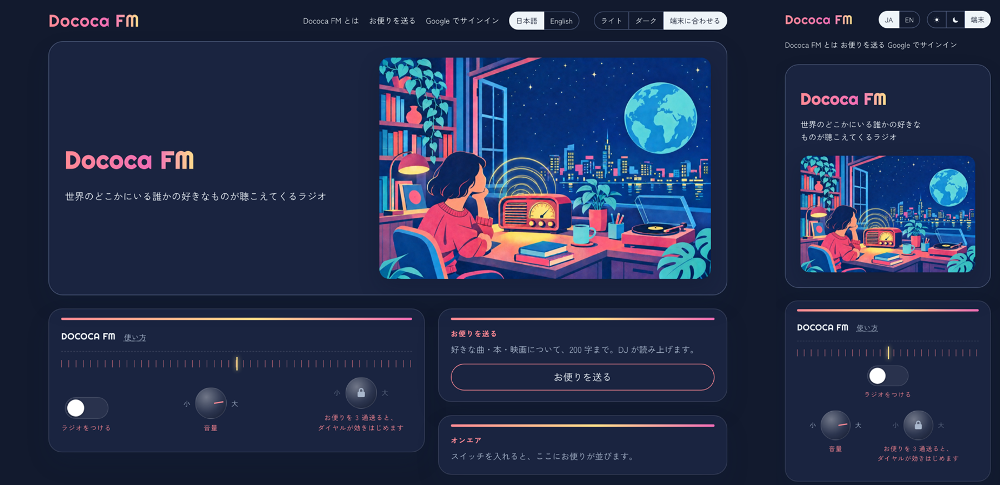

# Dococa FM

世界のどこかにいる誰かの好きなものが聴こえてくるラジオ。

Built with Claude: Japan 2026 への応募作です。本番: https://dococafm.app



ライトモードもあります（[docs/screenshots/2026-11-08-prod-home-light.png](docs/screenshots/2026-11-08-prod-home-light.png)）。

## なぜ作ったか

好きな曲や本や映画の話は、誰かに聞いてほしいし、誰かの好きな話も聞いてみたい。そして、まだ知らない好きなものに、ふと出会えたらうれしい。そういう時間を過ごせる場所を作りたくて、Dococa FM を作りました。

Dococa FM は、誰かが好きな作品について書いた「お便り」を、AI の DJ が紹介を添えて読み上げるラジオです。スイッチを入れると、世界のどこかの誰かのお便りが流れます。気に入ったら「私も」と、一言を返せます。ダイヤルを右に回すほど、自分の好みから少し離れたお便りも混ざり、新しい好きなものに出会えます。フォローも DM もランキングもありません。

## 30 秒で試す

1. https://dococafm.app を開き、「ラジオをつける」を押す（サインインは要りません）。DJ の紹介のあと、誰かのお便りが原文のまま読まれます。
2. 「いま届いているお便り」のカードを押すと、そのお便りから流れます。「私も」と一言は、サインインなしで返せます。
3. [/about](https://dococafm.app/about) に、聴く・送る・自分のラジオ・AI がしないこと。

お便りを送るには Google サインインが要り、ダイヤル（新しい出会い）はお便りを 3 通送ると効きはじめます。デモ動画では、解けたダイヤルと、送ったお便りが読まれるまでを見られます。

## AI に引いた線

| 線 | どう守るか |
|---|---|
| お便りを言い換えない | 読み上げ前に、台本のお便りの行をデータベースの原文と一字ずつ照合する（`verbatim`） |
| 出典の無い声を作らない | 「見つけた声」は投稿者名と元 URL が無ければ流さない（`sources`） |
| 時事を言わない | DJ の行に時事の語（昨夜・先日・新作…）と数え上げ（何通・何位）があれば落とす（`topical`） |
| 数字で人や作品を測らない | いいね数・ランキング・一致率を、画面にも DJ の言葉にも出さない |

検証はモデルを使わないコードで行い、落ちた台本は 1 回だけ書き直させ、それでも落ちれば保存も再生もしません。詳しくは下の「[AI がすること、しないこと](#ai-がすることしないこと)」と「[eval](#eval)」、仕組みは [docs/how-it-works.md](docs/how-it-works.md)。

## どう作ったか

Claude Code を中心に、Sonnet が実装し、Opus がレビューし、Codex を第二の目にして 5 日間で作りました。役割分担・数字・裁定の例は [docs/process.md](docs/process.md)、経緯と意思決定は [docs/history.md](docs/history.md) と [docs/adr/](docs/adr/README.md)。

## 何をするか

ホームの「ラジオをつける」を押すと、世界のどこかの誰かの好きなものが流れ続けます。AI の DJ が作品を紹介し、その作品に誰かが書いた一行の「お便り」が、原文のまま読まれます。1 つの枠で読まれるお便りは 1 通です。聴くだけでよく、返事は義務ではありません。スマホのブラウザでも聴けます。

- **サインインなしでできること。** ラジオを聴く、お便りに「私も」を押す、「一言を送る」。
- **Google でサインインするとできること。** 好きなものの登録、Spotify の取り込み、「お便りを送る」、「あなたのラジオ」の公開、マイページ。公開すると「〇〇さんのラジオ」として他の人が聴けます。公開に出るのはラジオネームだけで、Google の名前とメールアドレスは出ません。
- **お便りを送る。** 作品は「URL を貼る」か「題名で探す」で決めます（好きなものを登録している人は、そこから選ぶこともできます）。題名で探すのはサインイン済みのときだけで、iTunes・Google Books・TMDB（と、鍵があれば YouTube）を一度に探します。好きな作品のページからこの画面を開けるブックマークレットも、同じページにあります。Spotify をつなぐのは設定からです。
- **言語。** 画面は日本語と英語を、ヘッダの切り替えで選べます。言語を英語にすると、DJ も英語で話し、お便りは英訳で読みます。日本語圏以外のお便りは、選んだ言語の訳を読み、原文を切り替えて確かめられます。
- **ホームから。** ホームには自分のラジオ（ダイヤルつき）があり、聴いたばかりの番組が 3 つ並びます。ラジオの横に「お便りを送る」のパネルがあり、一度ラジオをつけたブラウザでは写真を畳みます。「お便りを送る」はその場のモーダルで開き、「いま届いているお便り」のカードは押すとそのお便りがすぐ流れます。
- **マイページ。** 上から、送ったお便り（共有と非公開にする）、届いた反応、公開ラジオの操作（URL のコピー・公開と非公開・URL の変更）、聴いたお便りの順に並びます。好きなものの欄はありません。
- **公開ラジオ。** 「〇〇さんのラジオ」には、持ち主が送ったお便りと、持ち主が一言を返したお便りが流れます（一言は、そのお便りのあとに読まれます）。好きなものからは組みません。まだ 1 通もなければ「まだお便りがありません」と出ます。
- **ダイヤルは、お便りを 3 通送ると効きはじめます。** 数えるのは、送ったお便りと、ほかの人のお便りに返した一言と「私も」です。それまでは面に出たまま回らず、錠の印と「お便りを 3 通送ると、ダイヤルが効きはじめます」が出ます。あなたの好みは、あなたが送ったお便りと、一言か「私も」を返したお便りの作品から作ります。好きなものと Spotify の取り込みは、好みに使いません。
- **X で共有。** 「いま流れている」カードとマイページから、お便りを X に共有できます（`https://x.com/intent/post`）。リンクのコピーと、対応する端末では共有シートも使えます。
- **初回のチュートリアル。** 初めてホームを開くと、スイッチ・ダイヤル・「いま流れている」・オンエア・サインインの順に、部品を 1 つずつ指して説明します。終えてもとばしても再び出ません。もう一度見るには `/?tour=1` を開くか、ラジオの面の「使い方」を押します。ラジオの音は鳴らしません。
- **名前の無い人の一言。** ラジオネームが未設定のまま一言を返すときは、欄の下の畳んだ 1 行から、ラジオネームとお住まいを添えられます（任意。設定と同じ規則で確かめ、一言が受け付けられたときだけ保存します）。
- **説明ページ。** ヘッダの「Dococa FM とは」から `/about` を開けます。聴く・送る・自分のラジオ・できることとしないことを 4 枚で説明します。
- **お住まい。** 設定の「お住まい」は、国と都道府県・州から選びます。お便りの送り主に添えて出ます。
- **お便りを共有する。** 1 通のお便りは `/letters/<id>` で開けます。作品・お便り（原文のまま）・私もと一言の欄と、そのお便りの分だけのプレイヤー（作品の名前・DJ の紹介・手渡し・お便り・DJ のひとこと）が並び、「ラジオで続きを聴く」で自分のラジオに移ります。X などに貼ると OGP のカードになります。X の player カード（`/letters/<id>/player`。ほかのサイトの iframe にも入れられます）は X 側の許可が要るため、タイムラインで聴けるかは未確認です。
- **反応のお知らせ。** 自分のお便りに人の「私も」や一言が届くと、ヘッダの「マイページ」に小さな点が付きます（数字は付けません）。マイページを開くと消えます。
- **取り下げ。** 送ったお便りは、マイページの「送ったお便り」から自分で非公開にできます（確認つき）。ラジオにも作品ページにも共有ページにも出なくなります。
- **公開ラジオ。** ホームの「お便りが届いた公開ラジオ」から、公開している人のラジオに入れます（ラジオネームとお住まいだけ。件数は出しません）。
- **冒頭の一行。** 作品の紹介の前に、定型で「〇〇の「△△」という曲の紹介です」と言います（曲・本・映画・動画。作品のデータを埋めるだけで、Claude の文ではありません）。
- **読み。** 読み間違えそうな名前の読み（PSY → サイ、大船渡 → オオフナト）をカタカナで付け、DJ の行の音声だけを変えます。作品の題名と作者の読みは、作品のデータだけを見せる別の呼び出しで作品ごとに 1 回だけ作ります（お便りは見せません）。語りと手渡しの名前の読みは台本係が返します。画面とお便りは書いたままです。
- **BGM。** 本人が Suno で作った 5 曲が、回ごとにランダムに流れます。
- **挿絵。** 説明ページ（`/about`）の 4 枚に、それぞれ挿絵が付きます。

### 三枠とダイヤル

番組は 1 回に 1 枠ずつ流れます。ラジオが次の回を頼むたびに、次の 3 種類から 1 枠を選びます。

| 枠 | 中身 | パーソナライズ |
|---|---|---|
| 近く | あなたの履歴やお便りにつながる作品 | する |
| 隣 | あなたの好きなものを好きな人が、ほかに好きな作品 | する |
| 遠く | 世界のどこかの一通。あなたとの接点は問わない | しない |

ダイヤル（新しい出会い）はラジオの面にあり、値はブラウザに残ります。ラジオは次の回を頼むたびにダイヤルの値を送るので、回すと次の回から効きます（作り置きの次の回は捨てて頼み直します）。左寄りは近く、中ほどは隣、右寄りは遠くを先に探し、見つからなければ遠く・近く・隣の順に探します。サインインしていれば、送った値はアカウントにも残ります。ダイヤルがあるのは自分のラジオ（ホームの面）だけで、世界のラジオ（Dococa FM）と人のラジオ（〇〇さんのラジオ）にはありません。ダイヤルはお便りを 3 通送るまでロック表示です。ロック中は中央の値で選び、保存した値は変えません。

ダイヤルが指すのは、正確には「遠さ」です。作品ごとに、題名・作り手・年・種類だけから Workers AI（`@cf/baai/bge-m3`）でベクトルを作っておきます。あなたの好み、つまりあなたが送ったお便りと一言か「私も」を返したお便りの作品（新しい順に最大 50）のベクトルの平均（無ければ聴いた作品。好きなものは使いません）を基準に、候補の作品を近い順に並べ、ダイヤルの位置の前後（±0.2、空なら少しずつ広げる）から 1 つを無作為に選びます。7 日以内に聴いたお便り（どの局で聴いたものも）と、このラジオの直近 3 枠の作品は外します（候補が尽きたら、聴いたお便りの制限から外します。作品は、まだ聴いていないお便りが残っていれば候補に残ります）。近く・隣・遠くの札（DJ のつなぎが言う枠）は、あなたの近くの枠の作品なら近く、それ以外は並びの前 3 分の 2 なら隣、残りは遠くです。遠さは選ぶためだけに使い、画面にも応答にもログにも DJ の言葉にも出しません。ベクトルがまだ無いあいだは、上の表の順に探します。反響（あなたのお便りへの私も・返信）は、このラジオで最後にお便りを聴いたときより新しいものがあれば、ダイヤルが遠くの端でない限り先に流れます。

## 材料の三層と見つけた声

DJ が語る材料は 3 層に分かれ、混ぜません。

1. **作品のデータ。** 題名・作者・年・画像など、公開 API や貼られた URL から得たもの。
2. **お便り。** この番組のリスナーが書いた一行。原文のまま載せ、翻訳は併記します。
3. **ネットで見つけた声。** 公開されたコメントのうち短いもの（100 字まで）を、投稿者名と元の URL を付けて引用します。「この番組へのお便り」とは別の枠に出し、各作品ページに削除依頼の口を置いています。出典の無い声は作りません。

見つけた声は、ローカルの収集バッチで YouTube のコメントから候補を拾い、Claude に ID だけを選ばせ、本人が目で確かめてから投入します。

### 放送のタイミング

いまは、送ったお便りがふつう数十秒〜15 分で、ほかの人のラジオに乗ります（審査員がすぐ聴けるように）。自分のラジオの選曲には自分のお便りは入りませんが、ホームのカードと共有ページ `/letters/<id>` からは、自分のお便りもすぐ聴けます。ハッカソンのあとは、ラジオの作法にならって 1 日 1 回の放送にし、お便りが翌日に読まれる形にする予定です（本人決定 2026-11-07）。詳しくは [docs/broadcast.md](docs/broadcast.md) にあります。

### 運用コスト

お便り 1 通あたり約 $0.04（約 6 円）で、聴く人が増えても増えません。日次の上限、単価の前提、削れるところは [docs/cost.md](docs/cost.md) にあります。

## AI がすること、しないこと

**すること。** 番組の台本（曲間の DJ の語り）を書く。お便りの判定（公開してよいか）と、日本語圏以外のお便りの翻訳。デモ用ペルソナのお便りの下書き。台本と一緒に、語りと手渡しで音声が読み間違えそうな名前や地名の読み（大船渡 → オオフナト）をカタカナで返す。作品の題名と作者の読み（PSY → サイ）は、作品のデータだけを見せる別の呼び出しで、作品ごとに 1 回だけ返す。読みが変えるのは DJ の行（冒頭の一行・語り・手渡し）の音声だけで、画面は書いたままの表記、お便りは音声も原文のままです。

**しないこと。**

- お便りを要約・言い換え・加工しない。画面でも番組でも原文のままです（前後の空白だけ除いて保存します）。非日本語のお便りは、番組では訳を読み、画面には訳の下に原文を出します。
- 時事を言わない（昨夜・先日・公開中・新作といった時事の語と、人数・順位・作品数などの数え上げ）。
- 数字で人や作品を測らない（件数・ランキング・一致率・再生回数）。
- 出典の無い「見つけた声」を作らない。

これらは台本を保存する前に、モデルを使わない決定的な検査で確かめます。

| 検証項目 | 見ること |
|---|---|
| verbatim | お便りの行が、データベースの原文と一字違わない |
| sources | 見つけた声に、出典の URL と投稿者名が付いている |
| topical | 時事の語（昨夜・先日・公開中・新作など）や、人数・順位・作品数などの数え方が DJ の行に無い |
| pii | 住所・郵便番号・メール・電話・URL・アカウント情報が無く、DJ がお便りを引用していない |

機械検査の対象は住所・郵便番号・メール・電話・URL です。名前と勤務先の組み合わせは、投稿時の判定とプロンプトで防ぎます。読み上げ（Web Speech / Gemini-TTS）は検査の外で、検査するのは保存する台本までです。作品の題名と作者名は、その作品へのお便りと同じ判定で確かめます。

検査に落ちた台本は、理由を添えて 1 回だけ書き直させます。それでも通らなければ、定型文だけの番組に切り替えます。検証に落ちた番組は、保存も再生もされません。

**道具の制限。** 台本を書くモデルに渡す道具は、台本を返す 1 つだけです（ネットも、ファイルも、DB も触れません）。見つけた声の収集バッチでは Claude Agent SDK を使い、道具を 1 つも渡さないうえで、呼ばれたら必ず拒否する hook も付けています。hook を使うのはこの収集バッチだけで、Worker 本体には入っていません。

## この作品について

- **期間内の新規制作。** このリポジトリのコードは、イベント期間中に新しく書いたものです。
- **過去の自作との関係。** 2020 年に作った音楽の出会いの Web サービス「musico」から引き継いだのは、問題設定と学びだけです。コード・文面・データ・UI は流用していません。
- **ベッド音。** ベッド音は本人が Suno で生成した 5 曲を `scripts/make-beds.sh`（ffmpeg）でループにしたもの。第三者の音源は含まない。

### musico との違い

1. DJ が語る。作品の曲間を、ラジオの DJ が声でつなぎます。
2. 一致率を出さない。数字で人や作品を測りません。
3. お便りは原文のまま、時間差で届く。要約も加工もしません。

## eval

番組を 20 回作り、保存された検証レポートと台本を集計します。方法と走らせ方は [docs/eval/README.md](docs/eval/README.md) にあります。

| 項目 | 結果 |
|---|---|
| verbatim の通過率 | 20 / 20（100%） |
| sources の通過率 | 20 / 20（100%） |
| topical の通過率 | 20 / 20（100%） |
| pii の通過率 | 20 / 20（100%） |
| 「遠く」枠が 1 つ以上ある回の率 | 20 / 20（100%） |
| 出所のある DJ 行の率 | 113 / 114（99%） |

2026-11-07 の昼に本番（dococafm.app）で 20 回走らせた結果です。走らせたのは Phase 5 の build で、eval スクリプトは 1 回に 6 席で頼みます（その後の Phase 6・7 で、冒頭の一行・読み・1 枠 1 通に変わりました。検証の規則は同じか厳しくなっています）。使ったデモのリスナーにはお気に入りが無く、どの回も「遠く」かランダムの選び方になったため、近い枠での結果ではありません。出所のない 1 行は、作品の英題を日本語名で呼んだ「江南スタイル」でした。

## 動かす

```bash
pnpm install
cp .dev.vars.example .dev.vars   # 鍵を入れる（.dev.vars は gitignore 済み）
pnpm db:migrate:local   # 初回だけ。pnpm dev の前に
pnpm wrangler login     # pnpm dev が Workers AI に繋ぐため
pnpm dev          # http://127.0.0.1:5173
pnpm test         # vitest + @cloudflare/vitest-plugin
pnpm typecheck
```

運用のスクリプトは、どれも `.dev.vars` を読みます。

| コマンド | 役目 |
|---|---|
| `pnpm eval` | 番組を 20 回作って検証レポートを集計する（上の eval） |
| `pnpm eval:units` | 単位を Claude に採点させる（単位の見直し） |
| `pnpm rejudge` | 公開済みのお便りを今の基準で判定し直す（お便りの選別） |
| `pnpm seed` | デモ用のお便りを投入する（デモ用のお便り） |
| `pnpm seed:reactions` | デモのペルソナに、公開中のお便りへ「私も」と一言を付けさせる（デモ用の反応） |
| `pnpm collect` | 見つけた声の候補を集める（ローカルのみ） |
| `pnpm db:migrate:local` / `pnpm db:migrate` | マイグレーションを開発 / 本番の D1 に当てる |

Workers AI（作品のベクトル）はローカルで動かせません。`pnpm dev` は起動のたびにリモートの Workers AI に繋ぐので、先に `pnpm wrangler login` が要り、使った分はそのアカウントに課金されます。テストは Workers AI に繋ぎません。

必要な鍵は `.dev.vars.example` に一覧があります。鍵は `.dev.vars` と Cloudflare secrets にだけ置き、リポジトリには入れません。

### デプロイ

Cloudflare Workers に載せます（D1 と R2 を使います）。本番の URL は https://dococafm.app です。

```bash
pnpm wrangler login
pnpm wrangler d1 create dococa            # 出力の database_id を wrangler.jsonc の d1_databases に書く（リポの値は本番のもの）
pnpm wrangler r2 bucket create dococa-audio
pnpm wrangler secret put ANTHROPIC_API_KEY   # .dev.vars.example の鍵を 1 つずつ（ADMIN_TOKEN、SESSION_SECRET、SPOTIFY_CLIENT_ID、GOOGLE_TTS_SA_JSON、GOOGLE_OAUTH_CLIENT_ID、GOOGLE_OAUTH_CLIENT_SECRET、TMDB_API_KEY、YOUTUBE_API_KEY、任意で GOOGLE_BOOKS_API_KEY）
pnpm db:migrate   # migrations/ の 0001〜0025 のうち、まだ当てていないものを順に当てる
# wrangler.jsonc の routes にカスタムドメイン、vars.PUBLIC_ORIGIN にその origin（例 https://dococafm.app）を書いてから
pnpm run deploy   # pnpm deploy は pnpm 組み込みの別コマンドなので、run を付ける
```

作品のベクトルには Workers AI を使います（`wrangler.jsonc` の `ai` バインディング `AI`。Workers Paid のアカウントで有効にします）。バインディングが無くても動き、そのときはダイヤルが枠の順を決めるだけになります。初めて有効にしたら、`/admin/prepare` を一度回して既存の作品のベクトルを作ります（次節）。

`wrangler.jsonc` の `routes`・`vars.PUBLIC_ORIGIN`・`d1_databases` の `database_id` は、この本番（dococafm.app）の値が入っています。fork して動かす人は 3 つとも自分の値に差し替えてください。`PUBLIC_ORIGIN` が空のままデプロイすると、`/healthz` 以外のすべてのリクエストが 500（`Server is not configured`）になります。デプロイ前に `vars` へ本番の origin を書いてください。`--var` で渡す方法は、次の `pnpm run deploy` で空に戻るので使いません。開発では `.dev.vars` の `PUBLIC_ORIGIN=http://127.0.0.1:5173` を使います。Spotify の redirect URI も同じ origin に合わせます。

`DEV_SKIP_CLAUDE=1` は開発専用です。`ANTHROPIC_API_KEY` が空のときに、お便りの判定と翻訳を素通しにします。本番の `vars` や secrets には入れません（入れなければ、鍵が空のときお便りの投稿は 503 で止まります）。

### Google サインインについて

Google Cloud の OAuth クライアント（ウェブ アプリケーション）を作り、承認済みのリダイレクト URI に `https://dococafm.app/auth/google/callback`（開発は `http://127.0.0.1:5173/auth/google/callback`）を登録します。同意画面は「本番」に公開します（テスト中のままだと、登録したテストユーザーしか入れません）。`GOOGLE_OAUTH_CLIENT_ID` が空のあいだ、`/auth/google` は 503 を返します。

### Spotify 連携について

Spotify 連携は開発モードのため、許可リストに入っているアカウントだけ使えます（本人と知人）。Spotify を使わない方は、作品の URL の貼り付けや題名の検索でお便りを送れます（好きなものの登録は要りません）。

### 守りと制限

書き込みの `POST` は同一オリジンのみ、好きなものの登録・お便り・マイページはサインイン必須、`/admin/*` は `ADMIN_TOKEN` 必須（スクリプトは Bearer、管理画面はブラウザの Basic 認証）、レート制限は書き込みと外部 API を呼ぶ経路で IP とリスナーごとに 1 分 20 回（題名検索 `GET /put?q=` はサインイン済みのリスナーごとに別枠で 1 分 20 回、`GET /tts` と `POST /listens` もそれぞれ別枠）です。詳しくは [SECURITY.md](SECURITY.md) にあります。レート制限のカウンタは Worker の isolate ごとのメモリにあるため、isolate をまたぐ厳密な上限ではありません。番組の作成は D1 を数える 1 日の枠の上限（`EPISODE_DAILY_LIMIT` 既定 60 枠、`EPISODE_GLOBAL_DAILY_LIMIT` 既定 1800 枠。1 回が 1 枠）が、クラウドの声は 1 日に合成する行数の上限（`CLOUD_TTS_GLOBAL_DAILY_LIMIT`、既定 3000）が、DJ の語り（単位）は 1 日に作る数の上限（`UNIT_DAILY_LIMIT`、既定 1000）が、お便りと一言は全員で 1 日に受け付ける数の上限（`LETTER_GLOBAL_DAILY_LIMIT`、既定 500。判定と翻訳で Claude を呼ぶため。「私も」は止めない）が、題名検索の YouTube は全員で 1 日に探す回数の上限（`YOUTUBE_SEARCH_DAILY_LIMIT`、既定 80。1 回で YouTube の枠を 100 ユニット使うため。超えたら YouTube だけ飛ばしてほかで探す。`0` は YouTube を探さない）が最後の歯止めです（`0` は停止）。単位が上限に当たった日は、新しいお便りを定型の手渡しだけで読みます。同じ行の音声は全員で共有し、上限を超えると `GET /tts` は 503 を返してブラウザの音声に切り替わります。ただし判定は原子的ではなく同時実行で数回超えることがあり、cookie を捨てる 1 人に全体の上限を使い切られうることも、[SECURITY.md](SECURITY.md) の既知の制限に書いています。

### public 化前チェックリスト（本人）

- [ ] リポの Settings → Code security で **Secret scanning** と **Push protection** を有効にする。同じ画面で **Private vulnerability reporting** も有効にする（SECURITY.md がそこへの報告を案内しているため）。
- [ ] `CLAUDE.md`・`docs/status.md`・設計書に残る知人の名前（伊豆部など）、手元の端末名やパス、Cloudflare のアカウント名を、公開してよいか見る。消すなら commit してから。
- [ ] Settings → Actions → General で、fork からの pull request の workflow は承認が要る設定にする（"Require approval for all outside collaborators"）。
- [ ] Settings → Branches（または Rulesets）で、`main` への直接 push を自分だけに限定する。
- [ ] 手元で `gitleaks detect --source .` を実行し、検出が 0 であることを確かめる（履歴全体が対象）。
- [ ] `.gitignore` に `.dev.vars`、`*.pem`、`.wrangler/`、`.found/` があることを確かめる（済み）。
- [ ] CI（`.github/workflows/ci.yml`）が main で緑になっていることを確かめる。
- [ ] 上が済んでから、Settings → General → Danger Zone で private を public に切り替え、提出する。

## デモ用のお便りについて

デモの密度を出すため、AI が作った架空のリスナー（多国籍のダミーアカウント）が、好きな作品に一言ずつ書いています。

- 画面・番組では、ラジオネームの横に「［デモ用］」の印が付きます。本人や知人のお便りと同じ場所に並びますが「デモ用」の印で見分けられます。
- 日本語圏以外の人は英語で書き、日本語の番組では日本語訳を、英語の番組では原文を読みます。画面には原文を併記します。
- 書かれた文は、判定を通ったあと一字も直さずに載せます。人物像は `docs/demo/personas.json` にあり、実在の人物ではありません。

```bash
# items.txt: 作品の URL を 1 行ずつ。ADMIN_TOKEN と ANTHROPIC_API_KEY は .dev.vars に
pnpm seed --items items.txt --personas 30 --dry-run   # 書かせるだけ。投入しない
pnpm seed --items items.txt --personas 30             # 投入して、作品ページに原文が出ることを確かめる
```

投入したお便りには、デモのペルソナから「私も」（1〜2 人）と、半分ほどに一言（Claude が各ペルソナの言葉で 120 字以内）を付けられます。後から届いたお便りにも、同じコマンドを再実行すれば付きます（デモのペルソナの反応がまだ無いお便りだけが対象。反応者は本人以外で、1 通に同じ人は 2 度付かない）。ペルソナの反応も、デモ用の印が自動で付きます。

```bash
# 本番のトークンは、先に `read -rs PROD_ADMIN_TOKEN` でシェルに読み込む
ADMIN_TOKEN="$PROD_ADMIN_TOKEN" pnpm seed:reactions --origin https://dococafm.app --dry-run       # 一言を書かせて計画を出すだけ。投稿しない
ADMIN_TOKEN="$PROD_ADMIN_TOKEN" pnpm seed:reactions --origin https://dococafm.app --per 2         # 私も は 1 通に最大 2 人
ADMIN_TOKEN="$PROD_ADMIN_TOKEN" pnpm seed:reactions --origin https://dococafm.app --letters <id,...>   # このお便りだけ（id は GET /admin/letters.json で見られる）
```

### お便りの選別（運用）

お便り・一言・返信・見つけた声は、公開の前に Claude が 6 つの理由で選別します。誰かへの攻撃・差別（abuse）、宣伝・勧誘（ad）、個人情報（pii）、作品の話からの逸脱（offtopic）、公序良俗に反する内容（obscene）、作品や作り手をけなすのが主体のもの（negative）です。そっけない一通、悲しい一通、辛口の一言は通します。判定できないときは公開せず 503 を返し（閉じる側に倒します）、「私も」は判定しません。基準を変えたあと、すでに公開したお便りを今の基準で判定し直すには、一度だけ次を実行します。

```bash
# 本番のトークンは、先に `read -rs PROD_ADMIN_TOKEN` でシェルに読み込む（履歴にもプロセスの引数にも残らない）
ADMIN_TOKEN="$PROD_ADMIN_TOKEN" pnpm rejudge --origin https://dococafm.app
# 20 通ずつ POST /admin/rejudge を、next が null になるまで回す。出すのは id・理由・件数だけで、本文は出さない
```

見つけた声も、お便りと同じく作品の題名・作者と一緒に判定します。断られたお便りは `rejected` になって公開面から消え、二度と判定されません。判定できなかったもの（skipped）は公開のまま残るので、もう一度実行すれば再判定されます。

### 事前生成（運用）

お便りが保存されると（`POST /letters`、`/admin/letters`、`/admin/found`）、Worker が応答のあとで、そのお便りの DJ の語り（単位）と音声を作っておきます。単位は日本語と英語の両方を作ります。15 分ごとの Cron（`wrangler.jsonc` の `triggers`）が、単位の無いお便りと音声の揃っていない単位を、日本語の単位・英語の単位・日本語の音声・英語の音声の順に埋めます。Cron と `/admin/prepare` は、その前にベクトルの無い作品のベクトルを作ります（20 作品で 1 件分の枠を使います）。1 回の実行でするのは、ベクトル・単位・音声を合わせて最大 `limit` 件（単位と音声はお便り × 言語。Cron は 20 件）です。`waitUntil` の仕事は応答から 30 秒ほどで打ち切られるため、`/admin/found` で多数の声を入れたときに応答の直後に用意されるのは先頭の数件で、残りは Cron か `/admin/prepare` が拾います。シードで大量に投入した直後は、手で回します。

```bash
# 1 回でベクトル・単位・音声を合わせて最大 limit 件（1〜50）。remaining が 0 になるか failed が変わらなくなるまで繰り返す
curl -s -X POST "$DOCOCA_ORIGIN/admin/prepare" -H "authorization: Bearer $ADMIN_TOKEN" -H 'content-type: application/json' -d '{"limit":20}'
# => {"units":..,"audio":..,"failed":..,"remaining":{"vectors":..,"units":{"ja":..,"en":..},"audio":{"ja":..,"en":..}}}
# remaining.vectors はベクトルの無い作品の数（Workers AI が無いあいだは全作品）
```

`GOOGLE_TTS_SA_JSON` が空のあいだは単位だけ作り、音声は `remaining.audio` に残ります。クラウドの声の 1 日の上限（`CLOUD_TTS_GLOBAL_DAILY_LIMIT`、既定 3000 行/日）に当たると音声はそこで止まり、翌日（日本時間）の Cron が続きを作ります。お便り 1 通で音声はおよそ 10 行（日本語と英語）、単位は 1 言語で Claude を 2〜4 回呼ぶので、大量にシードするならデモの前日に入れるか、その日だけ上限を上げます。

### 単位の見直し（運用）

DJ の語り（単位）は、本人が見直して育てます。管理画面 `/admin/units` で単位を一覧し、良い intro に 👍 を付けると、その言語の 👍 付き・検証済みの intro が新しい順に 5 件、次に作る単位の指示文に「良い例」として入ります（intro だけで、お便りの本文は入れません）。👎（作り直す）はその場で作り直し、新しい単位が検証を通って保存できたときだけ前の単位と置き換えます（音声も作り直します。別の処理が作っている最中なら 409、作れなかったときは前の単位を残して 503）。数が多いときは `pnpm eval:units` で Claude に 5 点満点で採点させ、`docs/eval/units-<日付>.md` の低い 10 件と「指示文への提案」を読んで、採る提案だけ手で指示文に入れます。`--remake` を付けると 2 点以下を作り直します。読み方は [docs/eval/units.md](docs/eval/units.md) にあります。

管理画面はブラウザで開きます。ユーザー名 `admin`、パスワードに `ADMIN_TOKEN` を入れる Basic 認証です（トークンを URL に入れないでください）。

```bash
open "https://dococafm.app/admin/units?lang=ja"          # ユーザー名 admin、パスワード ADMIN_TOKEN
ADMIN_TOKEN="$PROD_ADMIN_TOKEN" pnpm eval:units --origin https://dococafm.app --lang ja --limit 40 [--remake]
# ANTHROPIC_API_KEY が要る（.dev.vars から読む）。出すのは件数だけで、お便りの本文は出さない
```

## 後で

Gemini-TTS はサービスアカウントの JWT で認証するように切り替え済みです（鍵は secret `GOOGLE_TTS_SA_JSON`）。`GOOGLE_TTS_API_KEY` はもう読みません。
