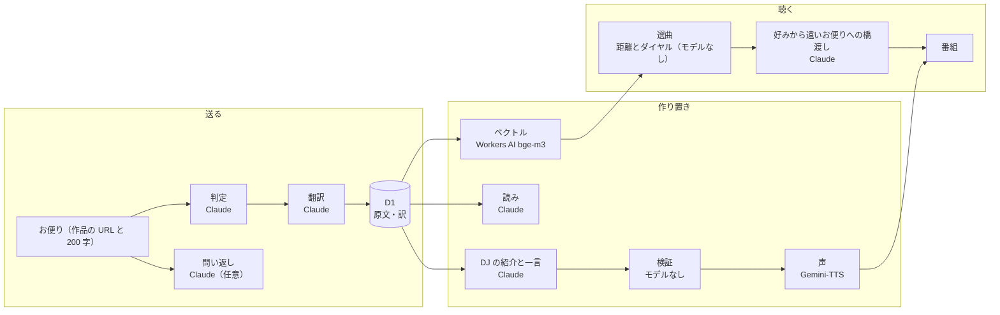

# Dococa FM の AI — どこで、何を、何をしないか

Dococa FM は「世界のどこかにいる誰かの好きなものが聴こえてくるラジオ」です。AI は、人が書いたお便りを変えずに届けるための裏方として使っています。この文書は、どの場面でどのモデルに何を渡し、何を返させ、返ってきたものをどう検査しているかを一枚にまとめたものです。細かい仕組みは [how-it-works.md](how-it-works.md)、守っている線は [README](../README.md) の「AI に引いた線」にあります。

## 一枚の図

## 場面ごとの使い方

| 場面 | モデル | 渡すもの | 返すもの | 検査 |
|---|---|---|---|---|
| お便りの判定 | Claude | 作品の題名・作者と本文 | ok か、断る理由（中傷・個人情報・作品と無関係 など） | 断ったお便りは保存しない |
| 翻訳 | Claude | 本文だけ | もう一方の言語の訳 | 長さや形が怪しい訳は捨てる（原文は常に残る） |
| ベクトル | Workers AI `bge-m3` | 作品は題名・作者・年・種類の 1 行。お便りは、その 1 行と本文 | 1024 次元のベクトル（作品は、お便りのベクトルの平均を混ぜた `vec_mix` も持つ） | 形が違えば捨てる。本文もベクトルもログに出さない |
| 読み | Claude | 作品の題名と作者 | カタカナの読み（PSY → サイ） | 読みが別の言葉を足していないこと |
| DJ の紹介と一言 | Claude | 作品 1 つとお便り 1 通（「私も」が届いたら、その土地名を最大 3。人数は渡さない） | 紹介（intro）と、お便りのあとの一言（after）と、固有名の読み | `verifyEpisode`。落ちたら 1 回書き直し、それでも落ちたら流さない。「私も」での書き直しは最初の 1 件と、3 つの国に広がったときの 2 回まで |
| 好みから遠いお便りへの橋渡し | Claude | 聴く人の作品（題名・作者・年・種類を最大 3。本文は渡さない）と次の作品 | 聴く人の作品を 1 つ名指しする 1 文（日本語 45 字、英語 90 字以内） | 同じ検査に加え、次の作品の題名を言っていない・自分の作品を 1 つ名指ししていることを機械で確かめる。落ちた・5 秒で返らない・1 日の上限（`BRIDGE_DAILY_LIMIT`、既定 400）のどれでも固定文「次は、少し遠くからのお便りです」。自分のラジオだけ。同じ人・同じ作品は保存した文を使い回す |
| 書きかけへの問い返し | Claude | 作品と書きかけ（200 字まで） | 答えなくてよい問いを 1 つ（日本語 60 字、英語 120 字以内） | 時事の語があれば出さない。書きかけを 8 字以上そのまま繰り返していたら出さない。書きかけは保存もログもしない。1 人 1 分 6 回まで |
| 声 | Gemini-TTS | 行ごとの文 | MP3 | 長すぎるクリップ（指示文を読んだ印）は作り直し。短い行は 2 回作って短い方（2 回読みを避ける） |

モデルを使わない部分: お便りの本文の照合（一字違わないこと）、時事・数・再生を促す語の検査、個人情報のパターン、7 日間の除外、選曲の距離計算と枠決め、BGM。

## 好みと「新しい出会い」

- 作品ごとのベクトルは、題名・作者・年・種類の 1 行と、その作品に届いたお便りの本文を混ぜたものです。同じ曲でも、「雨の日の曲」と書かれた作品は雨の日の側に寄ります。
- 聴く人の好みは、自分が送ったお便りの本文と、「私も」「一言」を返したお便りの本文のベクトルの平均です。好きなものの登録や Spotify の取り込みは使いません。
- ダイヤル「新しい出会い」は、候補との距離の順位で近い／隣／遠いに分け、どの棚から選ぶかを変えます。距離の値や順位は、画面にも DJ の言葉にも出しません。

## AI がしないこと（機械で確かめること）

- お便りに書き足しも言い換えもしない。読み上げる行が保存した原文と一字違わないことを、流す前に照合する。
- 出典の無い声を作らない。「見つけた声」は投稿者名と元 URL が無ければ流さない。
- 時事を言わない。数字で人や作品を測らない（人数・通数・順位・一致率）。再生や視聴を促さない。
- 紹介で送り主を名指ししない（送り主は定型文が言う）。
- 聴く人の書きかけ・本文・ベクトルをログに出さない。

## 費用の目安

Claude の呼び出しはお便り 1 通につき判定 1・翻訳 1・単位 2（日本語と英語）、作品 1 つにつき読み 1、「私も」での書き直しが最大 2。橋渡しは聴く人と作品の組ごとに 1（`BRIDGE_DAILY_LIMIT`、既定 400/日）、作品を選んだときの問いかけは表示ごとに 1（`ELICIT_DAILY_LIMIT`、既定 600/日）、問い返しは押すごとに 1（1 人 1 分 6 回）。声は同じ文なら 1 回だけ合成し、全員で使い回します。数字は [cost.md](cost.md)。
