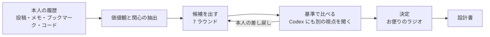

# Dococa FM の経緯

この文書は、Dococa FM がどう生まれ、どう作られ、聴いてどう直されたかを日付順にまとめたものです。個々の判断の理由は [docs/adr/](adr/README.md) に 1 件ずつ置いています。Claude と Claude Code の使い分けは [docs/process.md](process.md)、仕組みの図解は [docs/how-it-works.md](how-it-works.md) にあります。

設計の正本は `docs/superpowers/specs/2026-11-03-dococa-fm-design.md` です。追記 A〜O が、本人の差し戻しで何が変わったかの記録になっています。

## 1. 発端（2026-11-02〜11-03 朝）

Built with Claude: Japan 2026 の開発期間が 11-02 に始まり、提出は 11-08 20:00 JST でした。審査の重みは、インパクト 30・デモ 25・Claude の活用 25・深さと実行力 20 です。1 人で、公開リポで、期間中に新しく作るものだけが対象です。

### 案の出し方: 本人の履歴から価値観を取り出す

最初にしたのは、作るものを考えることではなく、本人が何を大事にしてきたかを確かめることでした。本人は Claude に、自分が何年も書いてきたものを読ませました。投稿、チームのやりとりに残した自分の発言、メモ、ブックマーク、GitHub のリポジトリです。読むだけで、どこにも書き込んでいません。あわせて、過去のハッカソンの受賞作と海外の似た製品も調べました。

読んだものから、繰り返し出てくる価値観と関心を抜き出しました。主なものは次のとおりです。

- 顔の浮かぶ小さな輪と、ゆるく弱いつながり。義務や熱意を求めない居場所。
- 人を数字やランキングで測らないこと。ノイズ・偶然・物語を残すこと。
- AI が何でもやる時代に、人に残るもの（物語、主観、好き嫌い）。
- 好みへの最適化に対する、偶然の出会い（セレンディピティ）。
- 自分の手で作って確かめること。本人が最初の利用者になれること。
- ラジオと DJ。何年も続いている、音楽と人のつながりへの関心。

これを物差しにして候補を出し、次の基準で比べました。

- 個人的な動機から出ていて、しかも誰にでも通じるか。
- 本人が最初の利用者になれるか。
- 1 人で 5 日で、端から端まで作れるか。
- Claude に本物の役目があるか（飾りの AI ではないか）。
- 審査の 4 つの観点と、イベントの禁止領域に合うか。

### 出ては消えた候補

候補は 7 ラウンドほど出し、そのたびに本人が差し戻しました。

- **仕事の現場の道具。** 本人の仕事に近すぎる、として外しました。
- **小さな友人グループのチャットの裏に置く AI。** チャットで誰にも拾われずに流れた一言を拾い、受け取るべき 1 人に原文のまま戻す、という案が一時は本命でした。AI が場で話さない点は良かったのですが、特定のチャットの道具と閉じたグループを前提にしていました。本人の使い方を一般の前提にしていたので、誰でも開ける製品になりませんでした。
- **コミュニティのボットと、エージェント同士の社交場。** 要約ボットや相談のチャットボットに見える、基盤に見える、AI が人の代わりに話してしまう、という理由で見送りました。
- **以前の自作の、Web サービスとしての作り直し。** 好きな曲を語り合う場をもう一度作る形です。期間中の新規制作に限られるうえ、語り合う場は同じ時間に人がそろわないと続かず、チャットルームが死ぬ失敗の型をなぞります。引き継いだのは問題設定だけでした。

消えた候補から残った考えもあります。「AI は話さず、人の言葉を原文のまま抜き出し、それをプログラムで確かめる」という形です。これが、のちの「お便りは原文のまま」の検査（[ADR 0002](adr/0002-verify-what-ai-must-not-do.md)）になりました。

### 音楽 × つながり、そしてラジオへ

11-03 の朝、方向を「音楽 × AI × つながり」に絞りました。本人は 2020 年に好きな曲を語り合う Web サービス「musico」を作っています。課題は次のように言い直しました。同じ熱量で話せる相手は、いないのではなく、同じ時間に同じ場にいない。熱量の差が見えると話せない。話したいのは好みの一致ではなく「その作品と自分」の物語である。

好みの一致で人を結ぶ製品は混んでいて、失敗の型も見えていました。一致率は浅い。チャットルームは死ぬ。AI が生成した MC は嫌われる。空いていたのは、作品と物語を時間差で一人に届ける形と、ラジオの「お便り」の形でした。

**なぜラジオか。** 深夜ラジオには、ゆるい共同体の作法がすでにあります。ラジオネームで書く、DJ が読む、返事は義務でない、聴くだけでいい。リスナー同士は DM をせず、番組を介して出会います。本人の答えは「AI ラジオの嫌悪より、深夜ラジオの親しみが勝つ」でした。

**なぜお便りか。** 番組の中身を、AI ではなく人が置いた一言にするためです。AI が何でも作れる時代に、人が自分の「好き」を自分の言葉で置くことに意味がある。DJ は AI でも、読まれる言葉は全部、誰かが書いたものです。お便りは、作品に心が動いたときに出る一行の軽さにしました。名前は「世界のどこかの誰か」から Dococa FM にしました。

## 2. 設計（2026-11-03）

ブレストの最後に、本人の一文が出ました。

> 自分が好きなものを好きな人が世界のどこかにいて、その理由が知れたら、人生がちょっとだけ豊かになる。

この一文を設計書の冒頭に置き、そこから次を決めました。

- **アンチゴール。** DM・プロフィール・一致率・マッチングはしない。いいね数・ランキング・人気順は出さない。お便りを要約しない。出典の無い声と架空のお便りは作らない。時事は言わない。全部を好みに最適化しない（「遠く」の枠を残す）。
- **AI がしないこと。** お便りは原文のまま。出典の無い「見つけた声」を作らない。DJ は時事を言わない。数字で人や作品を測らない。これをプロンプトの心がけではなく、モデルを使わない検査で確かめることにしました（[ADR 0002](adr/0002-verify-what-ai-must-not-do.md)）。
- **Claude の係と、決定的な検証。** 当初の設計では台本係・問い係・選曲係・翻訳係の 4 つを置きました。お便りの判定は運用の決めとして別に足しました。作った台本は 4 項目の検証（verbatim・sources・topical・pii）を通らなければ保存しません。選曲係は計画の段階でコードに移し、のちに埋め込みの距離で選ぶ形になりました（[ADR 0007](adr/0007-serendipity-by-embedding-distance.md)）。
- **材料の三層。** 作品のデータ、この番組へのお便り、ネットで見つけた声（短い引用、投稿者名と元 URL つき、別枠）。混ぜません。
- **削る順。** 核（番組の生成と再生、お便り、URL 貼り付け、作品ページ、ダイヤル、検証 4 項目など）は削らない。次に MCP の口とクラウドの声、その次に翻訳、最後に eval の自動化。締切に掛かったら後ろから落とす、という決めは以降の各 Phase の計画にも引き継ぎました。

同じ日の夜、デモの密度を出すために「［デモ用］の印を付けた AI のペルソナ」を足すと決めました（[ADR 0014](adr/0014-demo-data-as-labeled-ai-personas.md)）。

## 3. 技術選定（2026-11-03）

| 層 | 選んだもの | 理由 | 比べたもの |
|---|---|---|---|
| 実行環境 | Cloudflare Workers + D1 + R2（のちに Workers AI と Cron） | 1 つの Worker に全部を載せられ、聴く人が増えても固定費が小さい。音声のキャッシュを R2 に置ける | — （本人の決定。[ADR 0003](adr/0003-cloudflare-workers-d1-r2-workers-ai.md)） |
| 画面 | Hono 4 の JSX でサーバー描画、プレイヤーだけ hono/jsx/dom | 依存が最小で、Worker と同じ言葉で書ける | HonoX（alpha）、Astro（次点）、React の SPA、React Router、SvelteKit など（[ADR 0004](adr/0004-hono-jsx-without-client-framework.md)） |
| 台本と判定 | Claude Messages API、厳密な 1 ツールの tool use | Agent SDK は Node のプロセスで Worker 内で動かない。道具を絞れば、Claude が触れられるものを物理的に限れる | Agent SDK（収集バッチだけで採用）（[ADR 0005](adr/0005-claude-single-tool-no-network.md)） |
| 声 | Google Cloud の Gemini-TTS、ブラウザの音声を予備に | 自然文の指示で「落ち着いた深夜の DJ」を指定でき、日本語が使える | ブラウザの音声だけ、端末内のモデル（ネイティブ化と一緒に v2 へ）（[ADR 0006](adr/0006-gemini-tts-and-sha256-audio-cache.md)） |
| 遠さ | Workers AI の bge-m3（多言語の埋め込み） | 作品の題名・作り手・年・種類だけでベクトルが作れ、Worker から呼べる | Claude に選ばせる案（[ADR 0007](adr/0007-serendipity-by-embedding-distance.md)。11-06 に採用） |
| 器 | Web と PWA（Media Session API） | 審査する人が URL を開いて 30 秒で聴ける | ネイティブアプリ（v2 候補） |

## 4. 開発のサイクル（2026-11-03〜11-07）

### 進め方

計画を Task に分け、`superpowers:subagent-driven-development` で 1 つずつ進めました（[ADR 0015](adr/0015-subagent-driven-development-with-codex.md)）。指示役のセッションが、タスクごとに新しい実装者（Sonnet。設計判断を含むタスクは Opus）とレビュアー（Opus）を起こします。レビュアーは Critical / Important / Minor を付け、指示役が採るか断るかを台帳に残します。各 Phase の最後には全体のレビューを Claude と Codex（OpenAI、読み取りだけ）の両方から取り、両方の指摘を本人に見せてから直しました。

本人の役は、設計書の承認、本番を聴いての差し戻し、push とデプロイ、公開の判断です。

### Phase ごとの流れ

| Phase | 日付 | 主なテーマ | 本人が聴いて・見て変わったこと |
|---|---|---|---|
| 1 | 11-03〜11-05 | 計画 17 タスク（とデモのシード）。お便り・判定・翻訳・作品ページ・三枠とダイヤル・台本と検証・プレイヤー・Gemini-TTS・MCP・見つけた声・eval・公開前の整備 | 11-05 に本番へ出した。Gemini-TTS は API キーで使えず、サービスアカウントの署名に切り替えた |
| 2 | 11-05 | 入口を「スイッチを入れたら流れ続けるラジオ」に。Google サインイン、公開ラジオ、日本語と英語の画面、レトロフューチャーの見た目、お住まいの選択式 | 本人が画面の流れを組み替えた（追記 A〜G）。夜に「DJ は曲をかけない。紹介して、お便りを読む」と指摘があり（追記 I）、声は試聴して決めた |
| 3 | 11-06 | DJ の語りをお便りごとの「単位」に。音声を本文のハッシュで共有、つなぎの定型、事前生成、聴いた記録、英語の DJ | 費用が聴く回数でなくお便りの数に比例するようにした（追記 H・K）。本番で、声の指示文が読み上げられる問題が見つかった |
| 4 | 11-06 | ダイヤルをラジオの面に、1 回 1 枠、埋め込みの遠さ、MCP の撤去、ホームに届いたお便り、選別の理由を 6 つに、単位の改善ループ | Phase 3 の本番を聴いての差し戻し（追記 L） |
| 5 | 11-07 | 指示文の読み上げの見張りを実測で締める、話し方を簡潔に、ヘッダの言語切替、オンエアの欄、聞こえる BGM、カードを押してすぐ鳴るホーム、説明ページ | Phase 4 の本番を聴いて 2 回分の差し戻し（追記 M） |
| 6 | 11-07 | サービス仕様のレビュー（本人がすべて採用）。冒頭の一行、読み、お便りの共有ページ、反応の点、取り下げ、本人の 5 曲の BGM、ラジオの手ざわり | レビューの項目に、本人が冒頭の一行・読み・共有ページなどを足した（追記 N） |
| 7 | 11-07 夕〜 | 1 枠 1 通、公開ラジオの中身、マイページの並び、SNS への共有、初回のチュートリアル、ダイヤルはお便り 3 通で効きはじめる | 画面ごとの本人のフィードバック（追記 O） |

### 数字

コミット数・テスト数・計画のタスク数・migration の数は、[docs/process.md](process.md) の「数字」が正本です（提出時点の値に更新します）。この文書には写しません。

### 裁定の型

台帳に残った裁定には、繰り返し出た型がありました。

- **API の制約で計画を直す。** 使ったモデルは、ツールを強制する指定を受け付けませんでした。計画を「厳密なツール 1 つ + 指示文 + コードでの検証」に直しました（Phase 1）。
- **機械で保証できないことを、保証できる形に言い直す。** 「言い換えは機械で見抜けない」という指摘に対し、保証するのは「お便りの行が原文と一字違わないこと」と「DJ の行がお便りを引用しないこと」にしました。言い換えそのものは指示文と eval で扱い、README にそう書きました（Phase 1）。
- **安全のために経路を消す。** 状態を変える GET があると、リンクの先読みで番組が作られて枠を使います。POST に直しました（Phase 1）。
- **費用が小さく結果が同じ競合は、受け入れて書く。** 同じ作品のベクトルを 2 回作りうる件は直さず、SECURITY.md の既知の制限にしました（Phase 4）。

## 5. 本番を聴いて直したこと

いちばん効いたのは、本人が本番を聴いて差し戻した回でした（11-05 夜、11-06、11-07）。どれもコードを読むだけでは分からない種類の問題です。

- **DJ は「かける」のではなく、紹介してお便りを読む。** この局で曲は流れません。「次は〇〇です、どうぞ」「お聴きください」を検証の禁止語にしました（追記 I）。
- **声の指示文が読み上げられる。** Gemini-TTS が、話し方の指示を本文の前に読んでしまうことがありました。冒頭の挨拶が「Dococa FM の紹介」に聞こえたこともあります。本番の clip 364 本の長さを測り、1 文字あたりの秒数から見張りの閾値を決め直しました。超えた clip は捨てて作り直します（Phase 3 で発見、Phase 5 で締め直し）。
- **話し方。** 最初の指示は「ねっとり」寄りでした。落ち着いて澄んだ、簡潔な話し方に変えました。日本語の指示文は命令形、英語は説明形のままにしています。形を変えると読み上げられやすかったからです。
- **BGM が無音だった。** Phase 1 で置いた仮の音が、ほぼ無音のまま流れていました。自作のアンビエントに替え、そのあと本人が作った 5 曲を回ごとに流す形にしました。
- **ダイヤルが隠れていた。** 設定ページのスライダーをやめ、ラジオの面のノブにしました。番組を 1 回 1 枠にして、回したら次の枠から効くようにしました（追記 L）。
- **「このあとのお便り」が空だった。** 1 回 1 枠にしたので、スイッチを入れる前は何も並びませんでした。欄を「オンエア」にして、いま流れているお便りを先頭に出しました（追記 M）。
- **冒頭の一行。** DJ の紹介だけでは何の作品か分かりにくかったため、紹介の前に定型の「〇〇の「△△」という曲の紹介です」を言います。作品のデータを埋めるだけで、Claude の文ではありません（追記 N）。
- **読み。** 「大船渡」が別の読みで読まれました。読み間違えそうな名前にカタカナの読みを付け、DJ の行の音声だけを変えます（[ADR 0011](adr/0011-readings-from-work-data-and-per-unit.md)）。
- **1 枠 1 通。** 同じ作品の 2 通目を「同じ作品に、もう一通」でつなぐと、2 通目は冒頭の一行も紹介も無く始まりました。各お便りを独立した枠にしました（[ADR 0010](adr/0010-one-letter-per-segment.md)）。
- **言葉づかい。** 「土地」を「お住まい」に、手渡しを「〇〇にお住まいの、△△さんからのお便りです」にしました。定型の「別の方」は「別の人」にしました。

## 6. これから（ハッカソンのあと）

`docs/status.md` の「ハッカソン後」に置いたものです。

- 1 日 1 回の放送にして、お便りは翌日に読まれる形にする（[ADR 0013](adr/0013-daily-broadcast-after-hackathon.md)、[docs/broadcast.md](broadcast.md)）。
- cookie の無い GET でリスナーの行を作らない。いまはクローラーが叩くと行が増えます。
- Cloudflare 側の防御を足す。WAF のマネージドルール、Bot Fight Mode、書き込みの経路だけのチャレンジ、IP ごとの Rate Limiting ルールです（[ADR 0016](adr/0016-count-then-act-limits.md)）。
- 費用を削る。英語の単位を要るときだけ作る、判定と翻訳を小さいモデルに替える、音声の鍵をお便りと DJ の行で分ける、再試行の上限を下げる（[docs/cost.md](cost.md)）。
- 読みをカスタム発音で渡せる別の TTS を、切り替えの後ろに足す。
- 冷えた入口（好みが無い人に、お住まいの国を散らす）の効き方を見直す。いまは最初の 1 通を聴いた時点で「冷えた」でなくなるため、ほとんど効きません。
- 「好きなもの」の登録と Spotify の取り込みを撤去する。好みは送ったお便りと反応したお便りから作る形に移ったためです（追記 O）。
- 本人が選ぶ UI の細かい直し。
