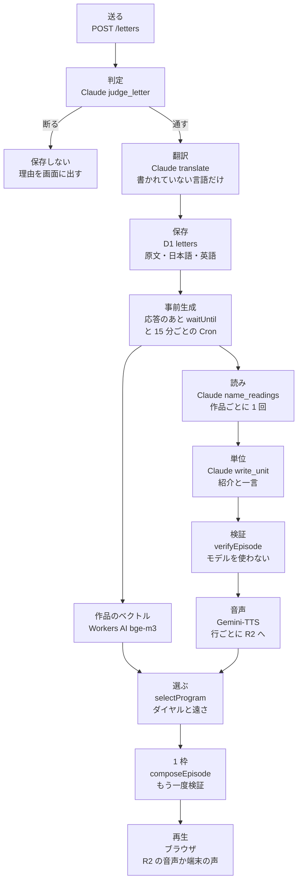
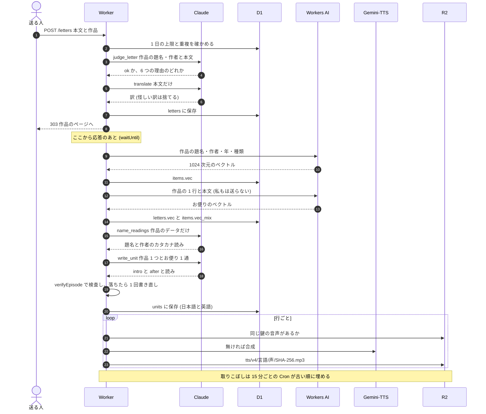
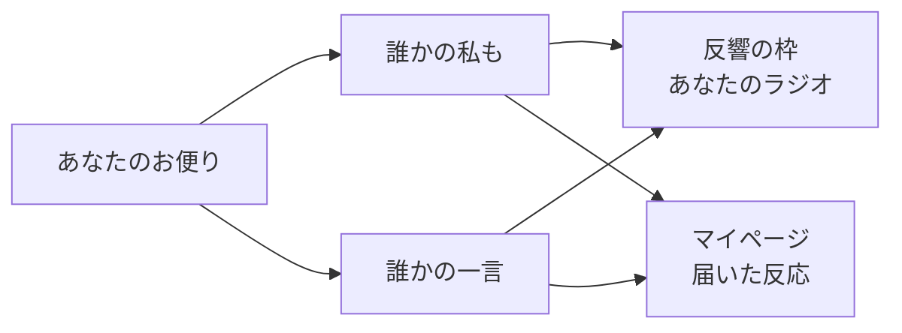
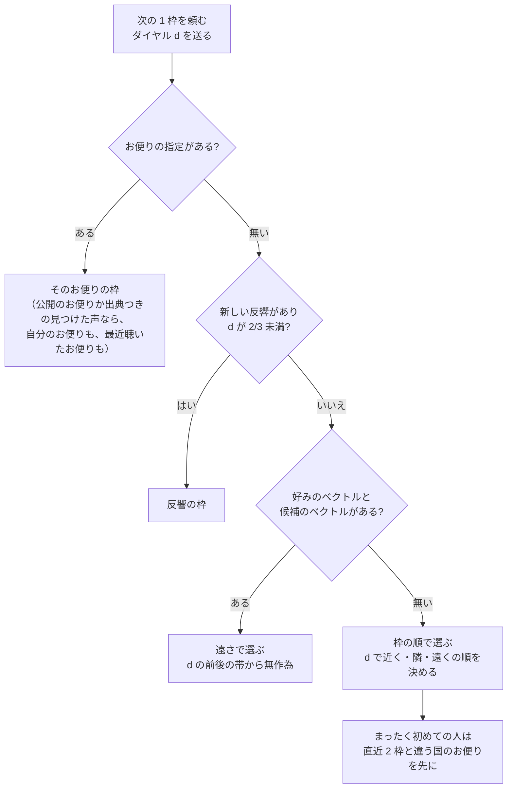

# 仕組みの図解 — お便りが放送に乗るまで

この文書は、送られたお便りや一言がどうラジオで読まれるか、「新しい出会い」のダイヤルが何をしているかを、図とコードの場所で説明します。対象は AI が関わる部分です。画面の使い方は [README.md](../README.md)、開発の進め方は [process.md](process.md) にあります。

## 1. 全体像



- 左の列（送る〜音声）は、お便り 1 通につき 1 回だけ走ります。
- 右の列（選ぶ〜再生）は、聴く人が次の枠を頼むたびに走ります。ここでは Claude も音声合成も、ふつうは呼びません。
- だから費用は「お便りの数」に比例し、「聴く回数」には比例しません（[cost.md](cost.md)）。

## 2. お便りが放送に乗るまで

### 送ってから音声ができるまで



**タイミング。** 投稿の応答を返したあと、Worker が `waitUntil` で同じお便りの準備を続けます。`waitUntil` の仕事は応答から 30 秒ほどで打ち切られます。終わらなかった分は、15 分ごとの Cron（`wrangler.jsonc` の `triggers.crons`）が拾います。Cron はベクトル → 読み → 日本語の単位 → 英語の単位 → 日本語の音声 → 英語の音声の順に、1 回 20 件まで埋めます。ハッカソンのあとは 1 日 1 回の放送にする予定です（[broadcast.md](broadcast.md)）。

### Claude の呼び出しごとに、見せるもの

Worker の中の Claude は、どの呼び出しでも道具を 1 つしか持ちません。ネットにも、ファイルにも、DB にも触れません。返事は道具の入力として受け取り、形が合わなければ捨てます。

| 呼び出し | 道具 | 見せるもの | 見せないもの | 失敗したとき |
|---|---|---|---|---|
| 判定 | `judge_letter` | 作品の題名・作者、お便りの本文 | 聴く人、ほかのお便り | 2 回試して駄目なら 503 で保存しない（断る側に倒す） |
| 翻訳 | `translate` | お便りの本文だけ | 作品、送り主 | 日本語訳の失敗は 503。英語訳の失敗は訳なしで保存 |
| 作品の読み | `name_readings` | 題名・作者・年・種類 | お便り、聴く人、台本 | 空の読みを保存し、書いたままを読む |
| 単位 | `write_unit` | 作品 1 つ、お便り 1 通（送り主の名前とお住まいを含む）、冒頭の一行、本人が 👍 した intro を最大 5 件 | 聴く人、ほかのお便り | 定型の行だけで読む |

- **単位**は「お便り × 言語」ごとに 1 つ作る DJ の語りです。`intro`（作品の紹介、160 字まで）と `after`（お便りへの短い感想、120 字まで）の 2 行で、聴く人が誰でも同じものを使います。
- 単位の指示文に入る「良い例」は intro だけです。だから、あるお便りの本文が別のお便りの指示文に入ることはありません。
- 送り主の名前とお住まいを単位に見せるのは、読み方を返させるためだけです。intro で送り主を名指しすると検査で落ちます。

### モデルを使わない部分

次の部分はコードが決めるので、毎回同じ結果になります。

- **冒頭の一行。** 「{作者}の「{題名}」という曲の紹介です。」のように、作品のデータを定型に埋めるだけです（`leadLine`）。
- **手渡し。** 「{お住まい}にお住まいの、{名前}さんからのお便りです。」も定型です（`handOver`）。
- **つなぎ。** 「次は、少し遠くからのお便りです。」などの定型です（`bridgeLine`）。
- **お便りの行。** データベースの本文をそのまま置きます（`read`）。モデルの出力がお便りの行に入る経路はありません。
- **検査**（`verifyEpisode`）、**選ぶ**（`selectProgram`）、**並べる**（`composeEpisode`）、**音声の見張り**（`spokeThePrompt`）。

### 何を保存して使い回すか

| もの | 保存先 | 鍵 | 作り直すとき |
|---|---|---|---|
| 判定と訳 | D1 `letters` | お便り | 本人が `pnpm rejudge` を回したときだけ |
| 作品のベクトル | D1 `items.vec` | 作品 | 作らない（作品のデータが変わらないため） |
| お便りのベクトル | D1 `letters.vec` | お便り | 作らない |
| 作品の混ぜたベクトル | D1 `items.vec_mix` | 作品 | お便りのベクトルができたとき、お便りが非公開になったとき |
| 作品の読み | D1 `items.reading_ja` | 作品 | 作らない |
| 単位 | D1 `units` | お便り × 言語 | 本人が管理画面で 👎 したとき |
| 音声 | R2 | 言語 × 声 × 読み上げる文の SHA-256 | 鍵の版（`tts/v4/`）を上げたとき |

同じ文は誰の番組でも同じ音声です。定型のつなぎや手渡しは、一度作れば全員で使います。

### 1 枠の並びと、2 度目の検査


単位は作ったときに 1 枠の形で検査します。通らなければ、理由を添えて 1 回だけ書き直させます。それでも通らなければ `verified = 0` で保存し、その単位の語りは使いません（定型だけで読みます）。

番組を組むとき（`buildEpisode`）、枠全体をもう一度検査します。落ちたら、落ちた枠の単位を外して検査し直します。それでも落ちたら、すべての単位を外します。定型だけの番組も落ちたら、その番組は保存も再生もされません。

1 枠で読むお便りは 1 通です。どのお便りも冒頭の一行から読みます。

### AI がしないこと

| 規則 | 機械で確かめる場所 | 中身 |
|---|---|---|
| お便りは原文のまま | `verify.ts` `verifyEpisode`（verbatim） | お便りの行が D1 の本文と一字違わないこと。送り主の表記も同じこと |
| DJ はお便りを引用・言い換えしない | `verify.ts` `verifyEpisode`（pii: quotes a letter） | DJ の行がお便りと 10 字（英語は 6 語）続けて重ならないこと。言い換えは指示文と eval で扱う |
| 出典の無い「見つけた声」を作らない | `verify.ts` `verifyEpisode`（sources）、`select-sql.ts` `readable` | 見つけた声に URL と投稿者名があること。無いものは選ばれない |
| 時事を言わない | `topical-words.ts` `TOPICAL`、`verify.ts`（topical） | 今日・先日・公開中・新作・季節の行事などの語 |
| 数字で人や作品を測らない | `verify.ts` `MEASURE`（measure） | 人数・通数・順位・ランキング・一致率・再生回数 |
| 再生や視聴を促さない | `verify.ts` `PLAYBACK`（playback） | かけます・お聴きください・どうぞ など |
| 個人情報を言わない | `verify.ts` `verifyEpisode`（pii）、`pii-patterns.ts` | メール・電話・URL・郵便番号・住所・アカウント情報 |
| 紹介で送り主を名指ししない | `verify.ts` `verifyEpisode`（intro） | intro に送り主の名前やお住まいが無いこと |
| 読みが別の言葉を足さない | `verify.ts` `verifyEpisode`（reading） | 音声が言う文が、行の名前を読みに替えただけであること |

読み上げる文（`spoken`）も、画面に出す文と同じ検査を受けます。

## 3. 一言と「私も」

「私も」と一言は、どちらもお便りへの反応です。保存先はお便りと同じ `letters` 表で、`kind` が `watashimo` か `reply`、`parentLetterId` に元のお便りの id が入ります。

- **付けられる相手。** 同じ作品の、公開中の、反応ではないお便りだけです（`createLetter`）。反応への反応は付けられません。
- **サインイン。** 要りません。匿名の cookie のリスナーでも置けます。
- **「私も」** は決まった文なので、Claude を呼びません。1 日の受付上限にも数えません。同じお便りに同じ人が 2 度は付けられません。
- **一言** は 200 字までの文で、お便りと同じ判定と翻訳を通ります。単位は作りません（DJ は定型の行で受け渡すだけです）。



**「私も」への DJ の反応。** 私も が届いたお便りは、DJ の単位（紹介と感想）を書き直します（`remakeForReaction`）。書き直すのは 2 回だけです。そのお便りの 1 件目の私もと、私もを返した人の `placeCountry` が初めて 3 つ以上になったときで、書き直した時点の私もの件数を `units.reactions_seen` に入れて、それぞれ 1 度だけ起きるようにしています。Claude に渡すのは、私もを返した人の土地（`place` の文字列、空は除く、最大 3 つ）だけです。本文・名前・件数は渡しません。感想の説明に「同じ気持ちの人がいることに一言触れてよい。人数や件数は言わない。土地は言ってもよい」と足します。検証は今までどおりで、数は `measure` が落とします。書き直し中と、書き直しが通らなかったときは、古い単位がそのまま流れます（日本語と英語の単位がある言語ごとに書き直します）。

**放送での扱い（反響の枠）。** 自分のお便りに、自分が最後に自分のラジオでお便りを聴いたときより新しい反応が届いていると、次の 1 枠はその作品の枠になります（`ECHO_SQL`）。ダイヤルが遠くの端（2/3 以上）のときと、お便りを指定して聴き始めたときは、反響を後回しにします。枠の最後に反応を最大 3 件読みます。「私も」は「{誰か}から『私も』が届いています」という定型の一行です。一言は「{誰か}から一言が届いています」のあとに、一言の原文（聴く人の言語の訳）を読みます。

**画面での扱い。** 作品のページと、マイページの「届いた反応」に出ます（共有ページ `/letters/:id` には、私もと一言を返す欄があります）。新しい反応が届くと、ヘッダの「マイページ」に点が付きます（数は出しません）。

**公開ラジオ。** 公開ラジオは、持ち主が送ったお便りと、持ち主が一言を返したお便りで組みます。持ち主の好きなものからは組みません。

## 4. 新しい出会い（ダイヤル）

### 作品のベクトルと、聴く人の好み

- **作品のベクトル。** 作品ごとに、題名・作者・年・種類をつないだ 1 行（例 `題名 — 作者 (年) [music]`）を Workers AI の `@cf/baai/bge-m3` に渡し、1024 次元のベクトルを作ります（`itemText`）。多言語のモデルなので、日本語の作品と英語の作品を同じ空間で比べられます。
- **お便りのベクトル。** 公開のお便りと一言は、作品の 1 行に本文（書いたままの言語）を改行でつないで同じモデルに渡し、お便りごとのベクトルを作ります（`letterText`、`letters.vec`）。同じ作品でも、何を好きと書いたかで位置が変わります。私もと見つけた声には作りません。作るのは、送った直後（応答のあと）と、`/admin/prepare` の回で残りを埋めるとき（`remaining.letterVecs`）。本文もベクトルもログには出しません。
- **作品の混ぜたベクトル。** 作品のベクトルに、その作品の公開のお便り・一言のベクトルの平均を足して長さ 1 にしたものです（`items.vec_mix`、`refreshItemMix`）。お便りのベクトルができたとき、お便りが取り下げ・非公開になったときに作り直し、漏れは `/admin/prepare` が埋めます。選曲で候補の遠さを測るときは、これがあればこれを、無ければ作品のベクトルを使います。
- **聴く人の好み。** 自分が送ったお便りと、私も・一言を返したお便り（最大 50、新しい順）のベクトルの平均です。自分のお便りはそのお便りのベクトル、私も・一言は返した先のお便りのベクトルを使い、まだ無ければ作品のベクトル（混ぜたものがあればそれ）で埋めます。どちらも無ければ、最近聴いたお便り（最大 20）のベクトルの平均を、同じ埋め方で使います（`standingOf`）。好きなものの登録と Spotify の取り込みは、好みに使いません。
- **ダイヤルのロック。** 送ったお便りと、私も・一言を返した人のお便りが合わせて 3 通に達するまで（自分のお便りに自分で返した一言は数えません）、ダイヤルは面に出たまま回せず、「お便りを 3 通送ると、ダイヤルが効きはじめます」と出ます。ロック中は中央の値で選び、保存した値は変えません。

### 次の 1 枠の選び方



**遠さで選ぶ手順**（`pickByDistance` → `farness` → `pickByDial`）は次のとおりです。

1. 候補は、他人が書いた公開のお便りか、出典つきの見つけた声がある作品です。多いときは無作為に 300 まで絞ります。
2. 最近のものを外します。直近 3 枠の作品と、7 日以内に聴いたお便り（どの局で聴いたものも）を外します（作品にまだ聴いていないお便りが残っていれば、その作品は候補に残ります）。候補が尽きたら、外す条件を 1 つずつ緩めます。
3. 各候補と好みのコサイン距離を測ります。
4. 距離を候補の中での順位に直し、0（いちばん近い）から 1（いちばん遠い）の「遠さ」にします。同じ距離の作品は同じ順位にします。
5. ダイヤルの値 d の前後 ±0.2 に入る候補から、1 つを無作為に選びます。帯が空なら 0.1 ずつ広げます。
6. つなぎの札を決めます。あなたの近くの枠（自分の好きなものや自分が書いた作品）なら「近く」です。それ以外は、遠さが 2/3 未満なら「隣」、それ以上なら「遠く」です。

遠さの軸と、ダイヤルの帯の関係を下に示します（d = 0.5 のとき）。

```text
 nearest                                                   farthest
 0.0              1/3              2/3                     1.0   farness (percentile among candidates)
 |-----------------|----------------|-----------------------|
       near             neighbor              far                label for the bridge line
                     [=======d=======]                           band d +/- 0.2  -> 0.3 .. 0.7
                  [==========d==========]                        empty? widen to +/- 0.3, 0.4 ...
```

- ダイヤルを左に回すと、好みに近い作品の帯から選びます。右に回すと、遠い作品の帯から選びます。
- 帯の中は無作為なので、同じダイヤルでも毎回違うお便りが来ます。
- ダイヤルの値は次の枠を頼むときに送ります。回すと、先読みした次の枠を捨てて頼み直します。

**ベクトルが無いとき。** Workers AI が無いときや、好みがまだ無いときは、ダイヤルが近く・隣・遠くの枠のどれを先に探すかだけを決めます。d が 1/3 未満なら近く、2/3 未満なら隣、それ以上なら遠くを先に探し、見つからなければ遠く・近く・隣の順に探します（`seatOrder`）。送ったお便りも反応も聴いた記録も無い初めての人には、直近 2 枠の送り主と違う国のお便りを先に出します（`FRESH_PLACE_LETTERS_SQL`）。

### 遠さを見せない理由

遠さの値は「選ぶ」ためだけに使い、画面にも、API の応答にも、ログにも、DJ の言葉にも出しません（`farness` は Worker の外に値を返しません）。外に出るのは、近く・隣・遠くの枠の札だけです（つなぎの言葉、番組の記録 `/episodes/:id`、次の回の応答の `slot`）。「あなたとの一致率 87%」のような数字は、人や作品を数字で測ることになるからです。これは「AI がしないこと」の「数字で人や作品を測らない」と同じ規則です。聴く人が知るのは、つなぎの言葉（「次は、少し遠くからのお便りです。」）だけです。

## 5. 声

### 行ごとの音声

- **合成。** Cloud Text-to-Speech 経由の Gemini-TTS（`gemini-2.5-flash-tts`、声は Charon）です。日本語は `ja-JP`、英語は `en-US` で、話し方の指示文（`DJ_STYLE_PROMPT`）を添えます。
- **1 行 1 本。** 番組の行（DJ の行とお便りの行）ごとに 1 本の MP3 を作ります。鍵は「言語 × 声 × 読み上げる文の SHA-256」です。同じ文なら、誰の番組でも同じ音声を R2 から返します。
- **聴くとき。** プレイヤーは行ごとに `GET /tts?episode=…&line=…` を頼みます。R2 に無ければ、その場で作ります（1 日の上限の内で）。

### 指示文の読み上げを見抜く

Gemini-TTS はときどき、指示文そのものを本文の前に読み上げます。その音声は、本文の長さに比べて明らかに長くなります。そこで、音声の長さを文字の種類ごとの上限と比べます（`spokeThePrompt`）。

| 文字 | 1 字あたりの上限 |
|---|---|
| かな・漢字など（CJK） | 0.27 秒 |
| それ以外（英字など） | 0.125 秒 |
| 行ごとのゆとり | 3 秒 |

上限は本番の音声を測って、きれいな音声の最も遅いものの少し上に決めました。上限を超えた音声は捨てて作り直します（1 回の要求で 3 回まで）。40 字以下の短い行は 2 本同時に作り、短いほうを使います（同じ文を 2 度読む失敗があるため）。同じ鍵で約 6 回払っても音声ができなければ、その行はあきらめて端末の声で読みます（`MAX_SYNTH_PER_KEY`）。

### 読み

読み間違えそうな名前（PSY → サイ、大船渡 → オオフナト）には、カタカナの読みを付けます。読みが変えるのは DJ の行の音声だけです。画面は書いたままで、お便りの行は音声も原文のままです。

- **作品の題名と作者の読み**は、作品のデータだけを見せる `name_readings` で作品ごとに 1 回だけ作ります（`askItemReading`）。お便りは見せません。読みを付けた冒頭の一行が検査を通らなければ、その読みは保存しません。
- **語りと手渡しの読み**は、単位と同じ呼び出しで `write_unit` が返します（日本語だけ。英語は書いたまま読みます）。
- **読みの制限**（`isReadingOf`、`keptReadings`）は次のとおりです。全角カタカナだけです。長さは元の英字・数字 1 字につき 3 字、漢字 1 字につき 2 字までです。元の表記が 40 字以内で、単位の行か送り主の名前・お住まいにそのまま出てくることが条件です。1 つの単位で 8 個までです。かなだけの名前と数字だけの文字列には付けません。条件に合わない読みは捨てます（単位は失敗にしません）。

### BGM と端末の声

- **BGM。** 本人が Suno で作った 5 曲（`public/bed-1.mp3` 〜 `bed-5.mp3`）を、最初の 1 曲だけ無作為に選んでプレイリストのように順に流し、一巡したら最初に戻します。枠が替わっても BGM は替えず、曲を途中で切りません。声の下に敷きます。
- **端末の声への切り替え。** 1 行の音声が取れない（上限で 503、ネットの失敗）とき、4 秒待ってもう一度頼みます。それでも駄目なら、その 1 行だけブラウザの音声（Web Speech）で読み、次の行はまたクラウドを試します。3 行続けて切り替わったら、その番組の残りはブラウザの音声で読みます（`playback.ts`）。

## 6. コストと上限

お便り 1 通あたりの費用の見積もり、単価の前提、削れるところは [cost.md](cost.md) にあります。聴くだけの要求（`/stations/:key/next`）は、ふつう Claude も音声合成も呼びません。

暴走しても青天井にならないよう、払う呼び出しの前に D1 の数を確かめます。厳密な予約ではないので、同時の要求で少し超えることがあります（[SECURITY.md](../SECURITY.md)）。

| 上限 | 既定 | 守るもの | 超えたとき |
|---|---|---|---|
| `LETTER_GLOBAL_DAILY_LIMIT` | 500 通 / 日 | 判定と翻訳（Claude） | お便りと一言を 429 で断る。「私も」は止めない |
| `UNIT_DAILY_LIMIT` | 1,000 単位 / 日 | 単位（Claude） | 新しいお便りを定型の手渡しだけで読む |
| `CLOUD_TTS_GLOBAL_DAILY_LIMIT` | 3,000 行 / 日 | 音声合成 | `/tts` が 503。ブラウザの音声で読む |
| `MAX_SYNTH_PER_KEY` | 1 行あたり約 6 回 | 指示文を読み続ける行への再試行 | その行をあきらめ、ブラウザの音声で読む |
| `EPISODE_DAILY_LIMIT` / `EPISODE_GLOBAL_DAILY_LIMIT` | 60 枠 / 人、1,800 枠 / 全体 | 番組の作成（D1 だけ） | 次の枠を 429 で断る |
| `YOUTUBE_SEARCH_DAILY_LIMIT` | 80 回 / 日 | 題名検索の YouTube | YouTube だけ飛ばし、ほかで探す |

`MAX_SYNTH_PER_KEY` 以外は環境変数で変えられ、`0` にするとその処理を止めます。日の区切りは日本時間です。

## 出典

この文書の記述は、次のコードで確かめました。

- `src/worker/letters/create.ts` `createLetter` — 判定と翻訳の順、私もの扱い、`parentLetterId` の条件、1 日の受付上限
- `src/worker/claude/moderate.ts` `moderateLetter` — `judge_letter`、6 つの理由、断る側に倒す
- `src/worker/claude/translate.ts` `translateLetter` — `translate`、本文だけを見せる
- `src/worker/letters/display.ts` `saneTranslation` — 怪しい訳を捨てる
- `src/worker/routes/letters.tsx` `POST /letters` — 応答のあとの `embedItems` と `prepareLetter`
- `src/worker/program/prepare.ts` `prepareLetter`、`prepareBatch` — 事前生成の順と 1 回の件数
- `src/worker/index.ts` `scheduled` と `wrangler.jsonc` `triggers.crons` — 15 分ごとの Cron
- `src/worker/ai/item-reading.ts` `askItemReading` — `name_readings`、作品のデータだけを見せる
- `src/worker/program/unit.ts` `writeUnitLines`、`makeUnit`、`isReadingOf`、`keptReadings` — `write_unit`、書き直し、読みの制限
- `src/worker/program/script.ts` `workTag`、`letterTag` — 単位の指示文に入るもの
- `src/worker/program/verify.ts` `verifyEpisode`、`MEASURE`、`PLAYBACK` と `topical-words.ts` `TOPICAL` — 決定的な検査
- `src/worker/program/compose.ts` `leadLine`、`handOver`、`letterLines`、`composeEpisode` — 1 枠の並びと定型の行
- `src/worker/program/build.ts` `buildEpisode` — 番組全体の検査と単位の外し方
- `src/worker/program/select.ts` `selectProgram`、`pickByDistance`、`seatOrder` — 反響、遠さ、枠の順、初めての人
- `src/worker/program/select-sql.ts` `ECHO_SQL`、`EXCLUDED_SQL`、`TASTE_OWN_SQL`、`TASTE_HEARD_SQL`、`FRESH_PLACE_LETTERS_SQL` — 候補と除外
- `src/worker/program/taste.ts` `standingOf`、`farness`、`pickByDial` — 好み、遠さの順位、±0.2 の帯
- `src/worker/ai/embed.ts` `itemText`、`letterText`、`embedItems`、`embedLetters` — bge-m3 に渡す文
- `src/worker/db/items.ts` `refreshItemMix` — 作品の混ぜたベクトル
- `src/worker/db/items.ts` `VEC_DIMS` — 1024 次元
- `src/worker/tts/google.ts` `spokeThePrompt`、`synthesizeShortTwice`、`synthesizeOnce` — Gemini-TTS と見張り
- `src/worker/tts/audio.ts` `audioKey`、`ensureAudio`、`MAX_SYNTH_PER_KEY` — 音声の鍵と 1 日の上限
- `src/worker/tts/style.ts` `DJ_STYLE_PROMPT` — 話し方の指示文
- `src/worker/routes/tts.ts` `GET /tts` — 行ごとの音声と 503
- `src/client/playback.ts` `createLinePlayer` — 行ごとの端末の声への切り替え
- `src/client/audio.ts` `createBed`、`BED_URLS` — 5 曲の BGM
- `src/client/station.tsx` — ダイヤルの値を次の枠の要求に載せる
- 1 枠 1 通と好みの設計: `docs/superpowers/plans/2026-11-07-dococa-fm-phase7.md` の Task 2 と Task 7、設計書の追記 O
